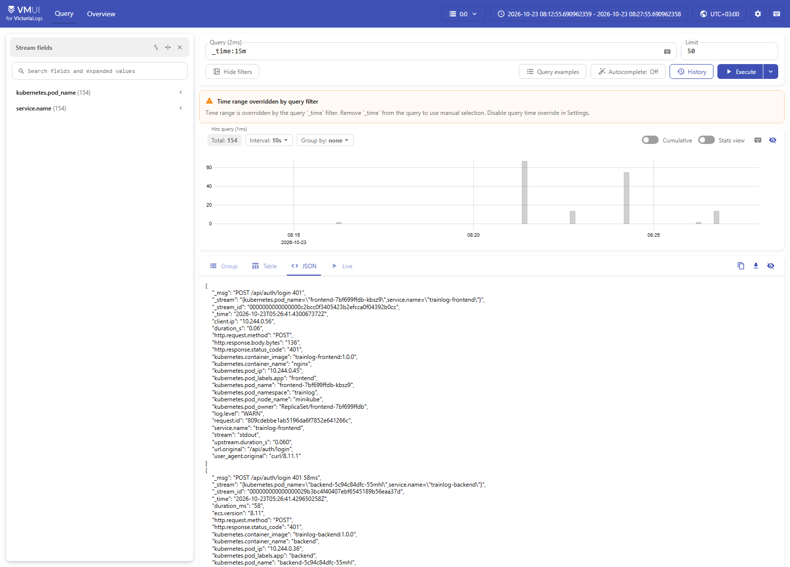
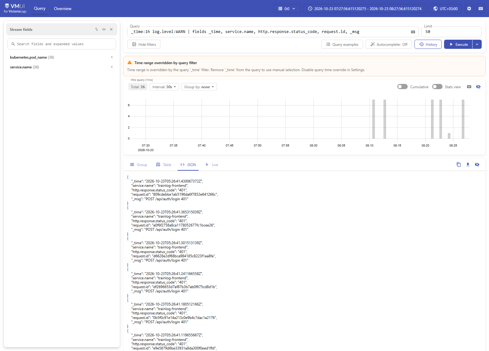
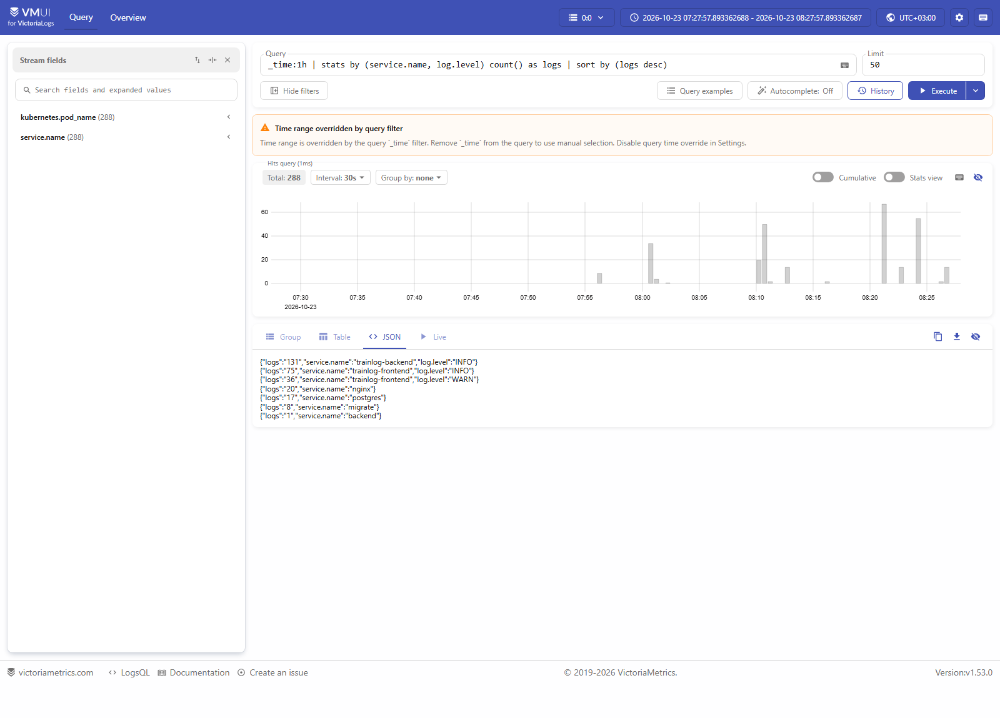
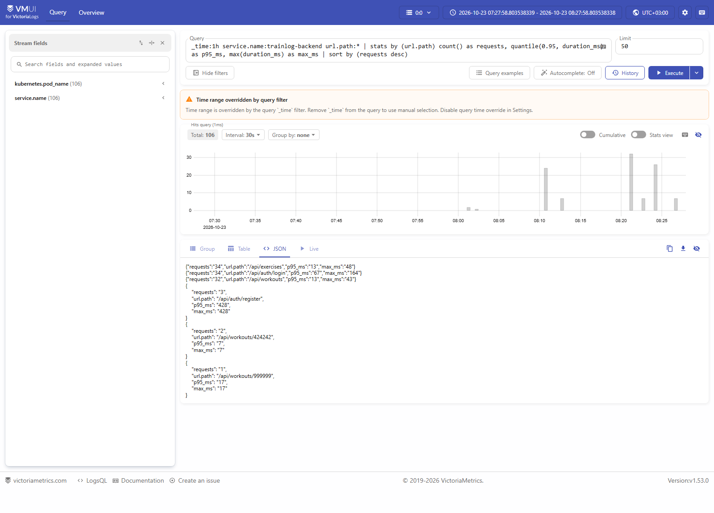
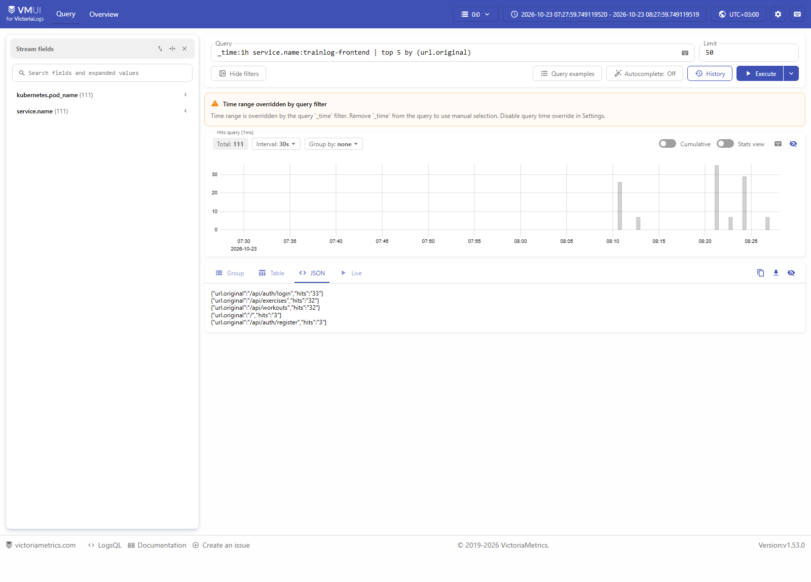
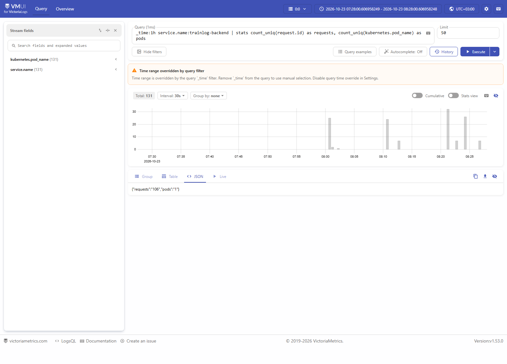
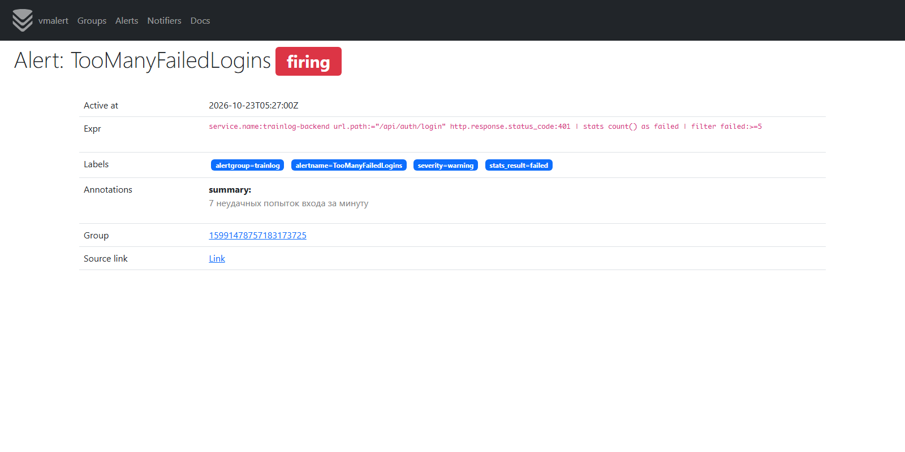

# Логи TrainLog в VictoriaLogs

Логи всех подов приложения собираются в VictoriaLogs (single-node), которая работает в том же кластере minikube.
Вся инфраструктура логирования вынесена в отдельный namespace `logging`.

| Компонент | Файл | Что делает |
|---|---|---|
| VictoriaLogs | `05-victorialogs.yaml` | хранит логи и выполняет LogsQL-запросы, в ней же встроен веб-интерфейс vmui |
| Vector | `06-vector.yaml` | DaemonSet: читает файлы логов контейнеров на узле и отправляет их в VictoriaLogs |
| vmalert | `07-vmalert.yaml` | раз в минуту выполняет LogsQL-запросы и поднимает алерты |

## Схема

```
 namespace trainlog              узел minikube            namespace logging
┌──────────────────┐                                   ┌──────────────────────────────────────┐
│ frontend (nginx) │                                   │                                      │
│ backend (Spring) │ stdout   /var/log/pods/*  чтение  │  Vector ── ES bulk ──► VictoriaLogs  │
│ migrate (Flyway) │ ───────► (файлы на узле) ───────► │ (DaemonSet)            (StatefulSet) │
│ db (postgres)    │                                   │                         │    ▲    ▲   │
└──────────────────┘                                   │                     PVC 2Gi  │    │   │
                                                       │            vmalert ─ LogsQL ─┘    │   │
                                                       └───────────────────────────────────┼──┘
                                                                  vmui, kubectl port-forward 9428
```

## Формат логов

Приложение пишет в stdout по одному JSON-объекту на строку. Имена полей взяты из
Elastic Common Schema (ECS), поэтому у фронтенда и бэкенда они совпадают.

| Поле | Пример | Откуда |
|---|---|---|
| `_time` | `2026-10-23T05:12:47.216Z` | время записи строки контейнерным рантаймом |
| `_msg` | `POST /api/auth/login 401 55ms` | поле `message` из лога |
| `log.level` | `INFO`, `WARN`, `ERROR` | бэкенд — уровень логгера; nginx — по статусу ответа (4xx → WARN, 5xx → ERROR) |
| `service.name` | `trainlog-backend`, `trainlog-frontend` | у текстовых логов (postgres, migrate) Vector подставляет имя контейнера |
| `service.version`, `service.environment` | `1.0.0`, `minikube` | версия из jar, окружение из ConfigMap (`APP_ENV`) |
| `request.id` | `1f060ac4…` | генерирует nginx и передаёт бэкенду в заголовке `X-Request-Id`, поэтому один запрос можно найти в логах обоих сервисов |
| `http.request.method`, `http.response.status_code` | `GET`, `401` | access-лог nginx и бэкенда |
| `url.path` / `url.original` | `/api/workouts` | путь запроса у бэкенда / исходный URI у nginx |
| `duration_ms` / `duration_s` | `43` / `0.043` | время обработки запроса у бэкенда / у nginx |
| `log.logger`, `process.thread.name`, `error.*` | | только бэкенд; при исключении в `error.stack_trace` попадает стектрейс |
| `kubernetes.*` | `kubernetes.pod_name` и др. | добавляет Vector: namespace, под, контейнер, образ, метки пода, узел |

Бэкенд использует встроенное в Spring Boot structured logging (`logging.structured.format.console: ecs`)
и `RequestLoggingFilter`, который пишет одну строку на каждый HTTP-запрос. Запросы к `/actuator`
(пробы Kubernetes) не логируются. В nginx задан собственный `log_format` с `escape=json`,
а запросы проб от kubelet (`User-Agent: kube-probe/*`) отфильтрованы.

## Доставка логов: Vector

Vector запущен как DaemonSet, то есть по одному поду на каждом узле кластера. Он использует источник
`kubernetes_logs`, который:

1. через API Kubernetes узнаёт, какие поды работают на его узле (для этого нужны ServiceAccount и
   ClusterRole с правами `get/list/watch` на pods, namespaces, nodes);
2. читает их файлы `/var/log/pods/<namespace>_<pod>_<uid>/<container>/*.log`. В minikube с Docker-рантаймом
   это симлинки на `/var/lib/docker/containers`, поэтому в под смонтированы оба каталога узла;
3. добавляет к каждой строке метаданные пода (`kubernetes.*`).

Собираются только поды приложения: namespace `trainlog` и наличие метки `app`
(`extra_field_selector` и `extra_label_selector`). Так в логи не попадают, например, временные
поды, запущенные через `kubectl run` для отладки.
Позиции чтения файлов сохраняются в `/var/lib/vector` на узле, поэтому после перезапуска Vector
продолжает с того же места и не отправляет логи повторно.

Трансформация `remap` (язык VRL) разбирает строку как JSON и раскладывает её по полям. Если строка
не JSON (Postgres, Flyway), она остаётся в `message` как есть. Заодно удаляются служебные поля,
которые только раздувают хранилище.

Отправка идёт через sink `elasticsearch` на `/insert/elasticsearch/`: VictoriaLogs поддерживает
ES bulk API. Как интерпретировать поля, задают заголовки:

| Заголовок | Значение | Смысл |
|---|---|---|
| `VL-Time-Field` | `timestamp` | время записи (его ставит Vector из лога рантайма, точность — наносекунды) |
| `VL-Msg-Field` | `message` | текст сообщения, становится полем `_msg` |
| `VL-Stream-Fields` | `service.name,kubernetes.pod_name` | из чего складывается поток (`_stream`); у одного пода в потоке однотипные записи, и они хорошо сжимаются |

### Почему Vector и DaemonSet

- **Приложение не знает о системе логов.** Сервисы просто пишут JSON в stdout, как требует
  12-factor. Ни в бэкенд, ни в nginx не нужно добавлять клиент VictoriaLogs, а при смене хранилища
  меняется только конфиг Vector.
- **DaemonSet, а не сайдкар.** Один под Vector на узел собирает логи всех контейнеров, в том числе
  Postgres, Flyway и nginx, в которые сайдкар добавить неудобно. Манифесты приложения не меняются,
  а при масштабировании бэкенда до N реплик не появляется N лишних контейнеров.
- **Метаданные Kubernetes.** `kubernetes_logs` сам подставляет namespace, под, контейнер и метки.
  Без них нельзя было бы отличить реплики друг от друга или найти логи конкретного пода.
- **Логи не теряются при падении пода.** Файлы остаются на узле, и Vector дочитывает их даже после
  того, как контейнер упал. Прямой push из приложения в этот момент потерял бы последние строки,
  а в них обычно и есть причина падения.
- **Vector, а не Fluent Bit или OTel Collector.** У VictoriaLogs есть готовая инструкция для Vector,
  а язык VRL позволяет в несколько строк разобрать JSON и навести порядок в полях. Fluent Bit
  справился бы не хуже; OpenTelemetry Collector имеет смысл, когда кроме логов собираются трейсы и метрики.

## Запуск

### 1. Кластер и образы

Кластер запускается так же, как в ДЗ №2:

```bash
minikube start
```

В этом ДЗ изменились бэкенд (JSON-логи, `RequestLoggingFilter`) и конфиг nginx, поэтому образы
нужно пересобрать. Сборка идёт сразу в Docker-демоне minikube:

```bash
eval $(minikube docker-env)                                                  # bash
& minikube -p minikube docker-env --shell powershell | Invoke-Expression    # PowerShell

docker compose -f docker-compose.yml build
```

### 2. Развёртывание

```bash
kubectl apply -f k8s/
kubectl -n trainlog rollout restart deploy/backend deploy/frontend
```

`rollout restart` нужен, если приложение уже было развёрнуто: тег образа остался прежним (`1.0.0`),
поэтому сам `kubectl apply` не заметит, что образ изменился, и не перезапустит поды.

Проверка:

```bash
kubectl get pods -n trainlog
kubectl get pods -n logging
```

Все поды должны быть в состоянии `Running` и `1/1`. В `logging` работают `victorialogs-0`,
`vector-xxxxx` и `vmalert-xxxxx`. Убедиться, что приложение пишет JSON:

```bash
kubectl -n trainlog logs deploy/backend --tail=3
```

### 3. Доступ к интерфейсам

Каждый port-forward работает, пока открыт терминал, поэтому каждую команду нужно запускать
в отдельном окне:

```bash
kubectl -n logging port-forward svc/victorialogs 9428:9428   # vmui
kubectl -n trainlog port-forward svc/frontend 8080:80        # приложение
kubectl -n logging port-forward svc/vmalert 8880:8880        # vmalert (бонус)
```

| Что | Адрес |
|---|---|
| vmui | http://localhost:9428/select/vmui/ |
| приложение | http://localhost:8080 |
| алерты vmalert | http://localhost:8880/vmalert/alerts |

Ошибка `bind: Only one usage of each socket address` означает, что порт уже занят, обычно другим
port-forward, запущенным раньше. Если интерфейс по адресу открывается, ничего делать не нужно.
Если не открывается, остановите старый процесс или выберите другой локальный порт,
например `9429:9428`.

### 4. Трафик

Логи появляются, только когда приложением пользуются. Откройте http://localhost:8080,
зарегистрируйтесь, добавьте тренировку и попробуйте войти с неверным паролем. Через 5–10 секунд
записи будут видны в vmui. Запрос вставляется в поле **Query** и выполняется кнопкой **Execute**.

Те же запросы можно выполнить через HTTP API. В PowerShell нужно писать `curl.exe`, потому что
`curl` там — псевдоним `Invoke-WebRequest`:

```bash
curl.exe http://localhost:9428/select/logsql/query --data-urlencode "query=_time:5m"
```

## LogsQL-запросы

Скриншоты сделаны в vmui на тестовом трафике: регистрация, просмотр упражнений и тренировок,
запрос несуществующей тренировки и серия неудачных попыток входа. Результаты показаны на вкладке
JSON. Во вкладке Group vmui ищет уровень в поле `level`, а у нас он в `log.level` по схеме ECS,
поэтому там все записи помечены как OTHER.

### а) Сырые записи за последние N минут

```
_time:15m
```

Показывает все записи за последние 15 минут со всеми полями, новые сверху. На скриншоте видна
одна запись nginx целиком: поля приложения (`http.*`, `request.id`, `log.level`), разобранные из JSON,
и метаданные `kubernetes.*`, которые добавил Vector. С такого запроса удобно начинать
разбор инцидента, когда ещё неизвестно, что искать.



### б) Фильтр по полю

```
_time:1h log.level:WARN | fields _time, service.name, http.response.status_code, request.id, _msg
```

Показывает предупреждения за последний час, то есть ответы фронтенда с кодом 4xx. `fields`
оставляет только нужные колонки. Здесь это серия `401` на `/api/auth/login` — неудачные попытки входа.
По `request.id` из любой строки можно найти парную запись бэкенда: `request.id:<значение>`.



Другие полезные фильтры по полям:

```
_time:1h service.name:trainlog-backend http.response.status_code:>=400   # ошибочные ответы бэкенда
request.id:0f4aa9297ec8d3d0e09b209d8dff8bd0                             # все записи одного запроса
log.level:ERROR                                                          # ошибки во всех сервисах
```

### в) stats с группировкой

```
_time:1h | stats by (service.name, log.level) count() as logs | sort by (logs desc)
```

Показывает, сколько записей каждого уровня написал каждый сервис за час. По этой таблице видно,
кто больше всех пишет в логи и не растёт ли доля WARN и ERROR. Строки без `log.level` — это текстовые логи:
Postgres, Flyway (`migrate`), сообщения entrypoint-скрипта nginx при старте и строка JVM про
`JAVA_TOOL_OPTIONS`, которую Java печатает до запуска логгера (`backend`).



### г) Агрегирующие запросы

**quantile** — нагрузка и время ответа бэкенда по эндпоинтам:

```
_time:1h service.name:trainlog-backend url.path:*
  | stats by (url.path) count() as requests, quantile(0.95, duration_ms) as p95_ms, max(duration_ms) as max_ms
  | sort by (requests desc)
```

Показывает для каждого эндпоинта число запросов, 95-й перцентиль и максимум времени ответа в
миллисекундах. Фильтр `url.path:*` оставляет только access-лог (у остальных записей бэкенда этого поля нет).
Вход и регистрация медленнее остальных, потому что пароль хешируется через BCrypt.



**top** — самые частые адреса во фронтенде:

```
_time:1h service.name:trainlog-frontend | top 5 by (url.original)
```

Показывает пять самых запрашиваемых URI и число обращений к каждому. Видно, что больше всего
обращений к `/api/auth/login`: это подбор пароля из тестового трафика.



**count_uniq** — число уникальных запросов и подов бэкенда:

```
_time:1h service.name:trainlog-backend | stats count_uniq(request.id) as requests, count_uniq(kubernetes.pod_name) as pods
```

Показывает, сколько разных HTTP-запросов обработал бэкенд и сколько его подов при этом писали
логи. После `kubectl -n trainlog scale deploy/backend --replicas=3` значение `pods` вырастет до 3.



## Алерты: vmalert

vmalert умеет выполнять правила прямо на LogsQL (`type: vlogs`). Правила лежат в ConfigMap
`vmalert-rules` и проверяются раз в минуту, каждый запрос смотрит на последнюю минуту логов.
Алерт поднимается, если `stats`-запрос вернул хотя бы одну строку.

| Алерт | Запрос | Когда срабатывает |
|---|---|---|
| `TrainlogErrors` | `log.level:ERROR \| stats by (service.name) count() as errors \| filter errors:>0` | в каком-либо сервисе появилась запись уровня ERROR; на каждый сервис — свой алерт |
| `TooManyFailedLogins` | `service.name:trainlog-backend url.path:="/api/auth/login" http.response.status_code:401 \| stats count() as failed \| filter failed:>=5` | за минуту 5 и более неудачных попыток входа, похоже на подбор пароля |

Alertmanager в кластере нет, поэтому vmalert запущен с `-notifier.blackhole`: алерты никуда
не отправляются, их видно в интерфейсе и API vmalert.

Проверка. Нужны port-forward к фронтенду и к vmalert, каждый в своём окне:

```bash
kubectl -n trainlog port-forward svc/frontend 8080:80
kubectl -n logging port-forward svc/vmalert 8880:8880
```

Затем в третьем окне отправить 7 запросов на вход с неверным паролем.

bash:

```bash
for i in 1 2 3 4 5 6 7; do
  curl -s -o /dev/null -X POST -H 'Content-Type: application/json' \
    -d '{"email":"admin@example.com","password":"guess'$i'"}' http://localhost:8080/api/auth/login
done
```

PowerShell (на каждый запрос выводится код ответа `401`):

```powershell
1..7 | ForEach-Object {
  $body = @{ email = 'admin@example.com'; password = "guess$_" } | ConvertTo-Json
  try { Invoke-RestMethod -Method Post -Uri http://localhost:8080/api/auth/login -ContentType 'application/json' -Body $body }
  catch { $_.Exception.Response.StatusCode.value__ }
}
```

То же можно сделать вручную: ввести на сайте неверный пароль 5 раз подряд в течение минуты.

Через минуту алерт появляется на http://localhost:8880/vmalert/alerts:



## Полезные команды

```bash
kubectl -n logging logs ds/vector                         # ошибки доставки
kubectl -n logging logs victorialogs-0
kubectl -n logging logs deploy/vmalert                    # ошибки выполнения правил
kubectl delete ns logging                                 # удалить всю инфраструктуру логов
kubectl delete clusterrole,clusterrolebinding vector      # кластерные объекты удаляются отдельно
```
