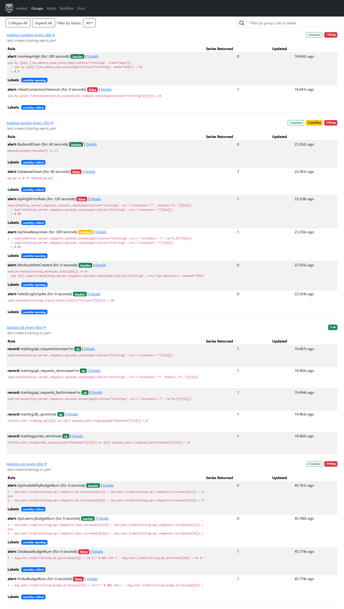
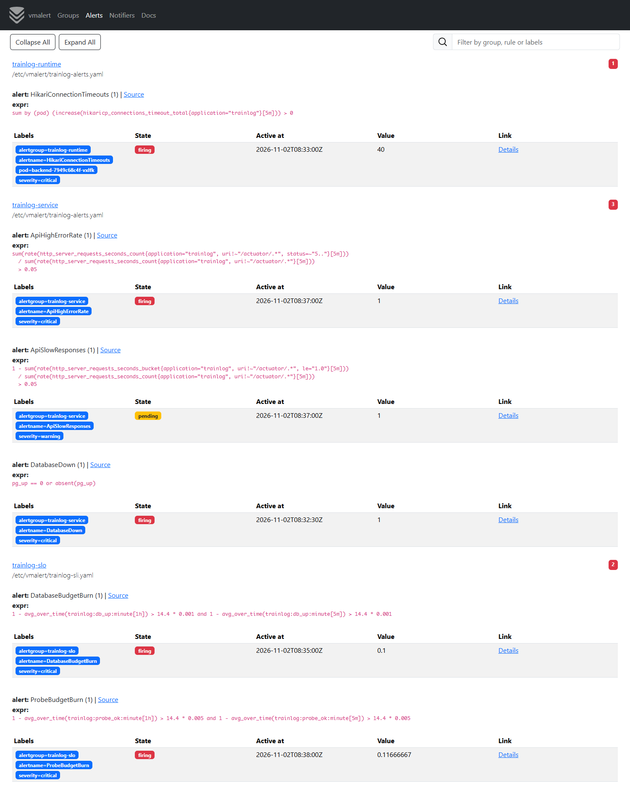
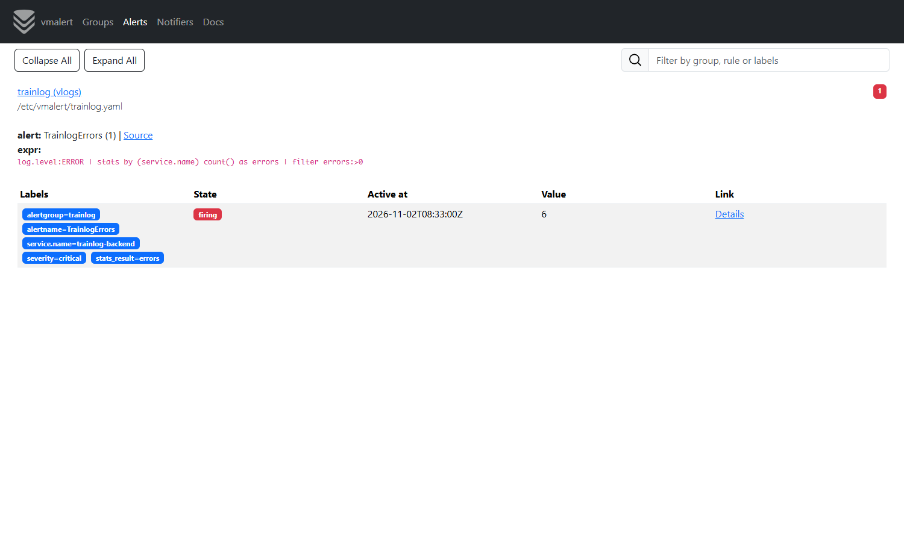
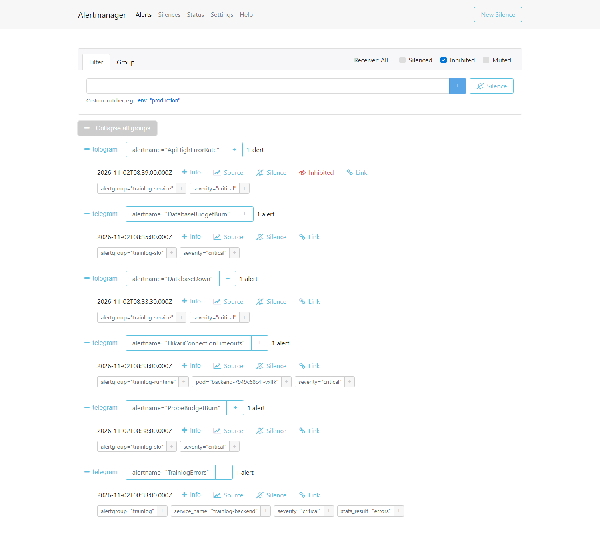
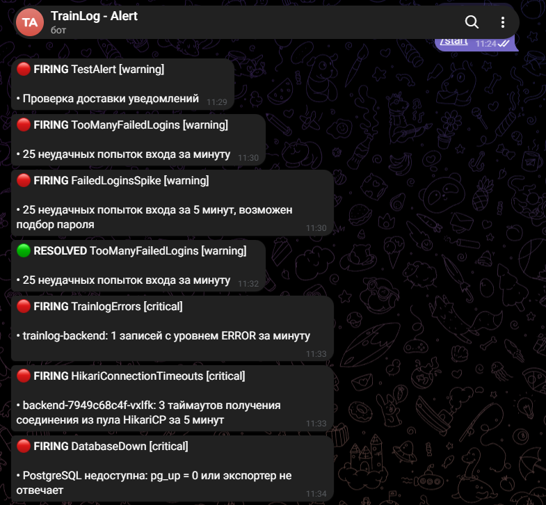
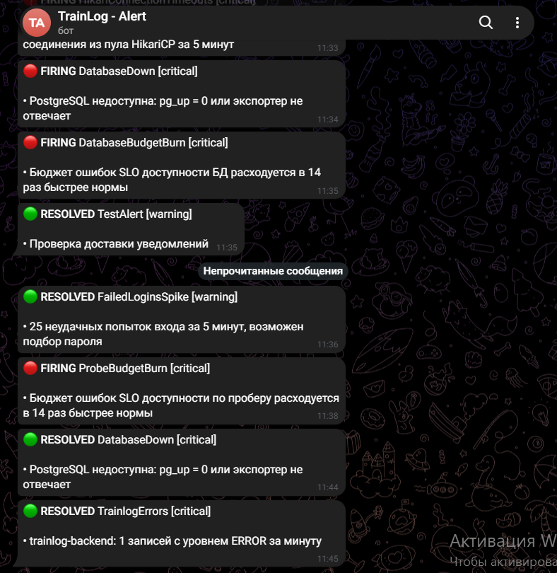
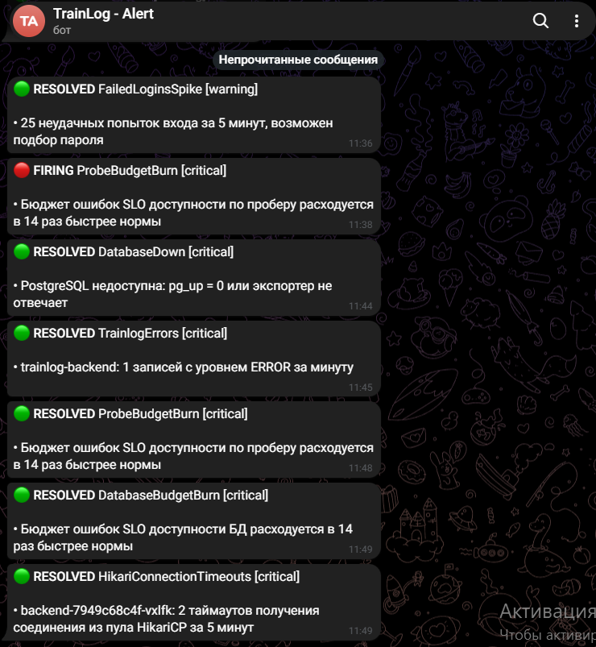

# Алерты и Alertmanager для TrainLog

Алерты считаются тем же vmalert, что и SLO из ДЗ №5 (`vmalert-slo` в namespace `monitoring`), по метрикам
из VictoriaMetrics. Раньше vmalert работал с `-notifier.blackhole`, теперь сработавшие алерты уходят
в Alertmanager, а он отправляет уведомления в Telegram.

## Что добавлено

| Что | Файл | Зачем |
|---|---|---|
| Правила алертов: группы `trainlog-service` и `trainlog-runtime` | `k8s/monitoring/alerts.yaml` | алерты на метрики сервиса и рантайма |
| Alertmanager с получателем Telegram | `k8s/monitoring/alertmanager.yaml` | группировка, подавление и доставка уведомлений |
| `-notifier.url` и второй ConfigMap с правилами в `vmalert-slo` | `k8s/monitoring/slo.yaml` | vmalert читает новые правила и шлёт алерты в Alertmanager |
| `-notifier.url` в vmalert для логов | `k8s/07-vmalert.yaml` | алерты по логам из ДЗ №3 тоже приходят в Telegram |

## Схема

```
 namespace trainlog              namespace monitoring                                namespace logging
┌──────────────────┐            ┌─────────────────────────────────────────────┐     ┌──────────────────┐
│ backend          │◄─ scrape ──┤ VictoriaMetrics                             │     │ VictoriaLogs     │
│ db-0 + exporter  │            │      ▲ запросы                              │     │      ▲ LogsQL    │
└──────────────────┘            │ vmalert-slo: slo-rules + trainlog-alerts    │     │ vmalert          │
                                │      │ алерты                               │     │      │           │
                                │      ▼                                      │     │      │           │
                                │ Alertmanager :9093 ◄────────────────────────┼─────┼──────┘           │
                                │      │ группировка, inhibit, повтор          │     └──────────────────┘
                                └──────┼──────────────────────────────────────┘
                                       ▼
                                   Telegram
```

## Какие алерты нужны сервису

TrainLog — REST API на Spring Boot и PostgreSQL. Пользователю важно, чтобы API отвечало, отвечало без ошибок
и быстро, и чтобы записанные тренировки сохранялись. Отсюда три уровня алертов:

1. **Сервис недоступен целиком** — бэкенд или база лежат. Нужна немедленная реакция.
2. **Сервис работает, но плохо** — много ошибок, медленные ответы, сломана основная операция, подозрительная
   активность. Пользователи уже страдают или скоро начнут.
3. **Причины в рантайме** — заканчивается память JVM, не хватает соединений с базой. Помогают понять,
   почему сработали алерты второго уровня, а память — заметить проблему до падения.

Алерты на сжигание бюджета ошибок (`*BudgetBurn`) из ДЗ №5 остаются: они отвечают на вопрос «выполним ли
SLO за месяц», а алерты ниже — «что сломалось прямо сейчас».

## Алерты на метрики сервиса

Группа `trainlog-service`, правила проверяются каждые 30 секунд. Запросы к `/actuator/*` из расчётов
исключены: это пробы kubelet и скрейпинг, а не пользовательский трафик.

| Алерт | Условие | `for` | Severity | Почему так |
|---|---|---|---|---|
| `BackendDown` | `absent(up{app="backend"} == 1)` — нет ни одного пода бэкенда, с которого удался скрейп | 1m | critical | `absent` срабатывает и когда под упал, и когда его нет совсем (`replicas=0`): в этом случае ряда `up` просто нет. Минута — чтобы не будить на обычном рестарте пода |
| `DatabaseDown` | `pg_up == 0 or absent(pg_up)` | 1m | critical | `pg_up = 0` — экспортер жив, а Postgres нет; `absent` — пропал весь под `db-0` |
| `ApiHighErrorRate` | доля ответов 5xx за 5 минут > 5 % | 2m | critical | 4xx не считаются: это ошибки клиента. 5 % — заметно выше фона (в норме 0), но выше единичных сбоев; 2 минуты отсекают короткие всплески |
| `ApiSlowResponses` | доля запросов дольше 1 с за 5 минут > 5 % | 5m | warning | По бакету `le="1.0"` гистограммы, без интерполяции квантилей. Это то же, что p95 > 1 с. Медленно — не сломано, поэтому warning и долгий `for` |
| `WorkoutsNotCreated` | счётчик `trainlog_workouts_total` за 5 минут не вырос, а запросы `POST /api/workouts` за это время были | — | warning | Бизнес-метрика ловит то, чего не видят технические: например, после релиза все создания отклоняются с 400 — ошибок 5xx нет, SLO доступности зелёный, а тренировки не сохраняются |
| `FailedLoginsSpike` | неудачных входов `trainlog_logins_total{result="failure"}` за 5 минут > 20 | — | warning | Человек ошибается паролем 1–3 раза, 20 за 5 минут — похоже на подбор пароля |

Правила `WorkoutsNotCreated` и `FailedLoginsSpike` построены на бизнес-метриках из ДЗ №4.

```yaml
- alert: ApiHighErrorRate
  expr: |
    sum(rate(http_server_requests_seconds_count{application="trainlog", uri!~"/actuator/.*", status=~"5.."}[5m]))
      / sum(rate(http_server_requests_seconds_count{application="trainlog", uri!~"/actuator/.*"}[5m]))
      > 0.05
  for: 2m
  labels:
    severity: critical
  annotations:
    summary: '{{ $value | humanizePercentage }} запросов к API за 5 минут завершились ошибкой 5xx'

- alert: WorkoutsNotCreated
  expr: |
    sum(increase(trainlog_workouts_total[5m])) == 0
      and on() sum(increase(http_server_requests_seconds_count{application="trainlog", uri="/api/workouts", method="POST"}[5m])) > 0
  labels:
    severity: warning
```

Вторая часть `WorkoutsNotCreated` нужна, чтобы алерт не срабатывал ночью, когда тренировки просто никто
не создаёт.

## Алерты на метрики рантайма (Spring Boot Actuator)

Группа `trainlog-runtime`. Метрики отдаёт Actuator через Micrometer, в коде ничего не менялось.

| Алерт | Условие | `for` | Severity | Почему так |
|---|---|---|---|---|
| `JvmHeapHigh` | `jvm_memory_used_bytes{area="heap"}` / `jvm_memory_max_bytes{area="heap"}` > 90 % по поду | 5m | warning | После сборки мусора heap освобождается, поэтому 5 минут подряд выше 90 % — признак утечки или нехватки памяти. Это предупреждение до `OutOfMemoryError` и OOMKill пода |
| `HikariConnectionTimeouts` | `increase(hikaricp_connections_timeout_total[5m]) > 0` по поду | — | critical | Каждый таймаут — запрос, который 30 секунд ждал соединение и получил 500. В норме их ноль, поэтому срабатывает с первого. Причина — база недоступна или тормозит, либо пул мал для нагрузки |

```yaml
- alert: JvmHeapHigh
  expr: |
    sum by (pod) (jvm_memory_used_bytes{application="trainlog", area="heap"})
      / sum by (pod) (jvm_memory_max_bytes{application="trainlog", area="heap"} > 0)
      > 0.9
  for: 5m

- alert: HikariConnectionTimeouts
  expr: sum by (pod) (increase(hikaricp_connections_timeout_total{application="trainlog"}[5m])) > 0
```

В `JvmHeapHigh` знаменатель отфильтрован `> 0`: у G1 пулы Eden и Survivor отдают `max = -1`, и предел
всей кучи задан только у Old Gen. Сейчас на стенде отношение около 0,12.

## Alertmanager

Конфигурация в ConfigMap `alertmanager` (`k8s/monitoring/alertmanager.yaml`):

```yaml
route:
  receiver: telegram
  group_by: [alertname]
  group_wait: 30s
  group_interval: 2m
  repeat_interval: 4h
  routes:
    - matchers: [severity = "critical"]
      receiver: telegram
      repeat_interval: 1h

inhibit_rules:
  - source_matchers: [alertname = "DatabaseDown"]
    target_matchers: [alertname =~ "ApiHighErrorRate|ApiSlowResponses|WorkoutsNotCreated"]
  - source_matchers: [alertname = "BackendDown"]
    target_matchers: [alertname = "WorkoutsNotCreated"]

receivers:
  - name: telegram
    telegram_configs:
      - bot_token_file: /etc/telegram/token
        chat_id: CHAT_ID
        parse_mode: HTML
        message: ...
```

| Настройка | Значение |
|---|---|
| `group_by: [alertname]` | один алерт по нескольким подам приходит одним сообщением |
| `group_wait: 30s` | ждём, не придут ли в группу другие алерты, прежде чем отправить первое сообщение |
| `group_interval: 2m` | изменения в уже отправленной группе (новые поды, решённые алерты) — не чаще раза в 2 минуты |
| `repeat_interval` | warning напоминается раз в 4 часа, critical — раз в час, пока не решён |
| `inhibit_rules` | когда лежит база, ошибки и медленные ответы API — её следствие; приходит одно сообщение о причине, а не четыре. `HikariConnectionTimeouts` не подавляется: он показывает, что пользователи действительно получают ошибки |

Уведомление о решении (`RESOLVED`) отправляется по умолчанию (`send_resolved: true`).

Токен бота и chat_id в репозиторий не попадают, они хранятся в Secret `alertmanager-telegram`. Токен
Alertmanager читает из файла (`bot_token_file`), а chat_id в конфиге может быть только числом, поэтому
его подставляет initContainer: `sed` заменяет `CHAT_ID` в шаблоне из ConfigMap и кладёт готовый конфиг
в `emptyDir`.

### Подключение vmalert

`vmalert-slo` монтирует оба ConfigMap с правилами в один каталог через `projected`-том и отправляет
алерты в Alertmanager:

```yaml
args:
  - -rule=/etc/vmalert/*.yaml
  - -notifier.url=http://alertmanager:9093
volumes:
  - name: rules
    projected:
      sources:
        - configMap:
            name: slo-rules
        - configMap:
            name: trainlog-alerts
```

vmalert для логов (`k8s/07-vmalert.yaml`) отправляет в тот же Alertmanager по полному DNS-имени
`alertmanager.monitoring.svc.cluster.local`, поэтому `TrainlogErrors` и `TooManyFailedLogins` из ДЗ №3
тоже приходят в Telegram.

## Развёртывание

Команды для PowerShell из корня репозитория. Кластер, приложение и VictoriaMetrics развёрнуты по ДЗ №2–5.

### 1. Бот Telegram

1. В Telegram написать [@BotFather](https://t.me/BotFather) команду `/newbot`, задать имя — он пришлёт токен.
2. Написать своему боту любое сообщение (или добавить его в группу).
3. Узнать chat_id: открыть `https://api.telegram.org/bot<токен>/getUpdates`, значение `message.chat.id`.
   У группы оно отрицательное.

### 2. Secret и манифесты

```powershell
kubectl -n monitoring create secret generic alertmanager-telegram --from-literal=token=<токен> --from-literal=chat-id=<chat_id>
kubectl apply -f k8s/monitoring/alerts.yaml -f k8s/monitoring/alertmanager.yaml -f k8s/monitoring/slo.yaml
kubectl apply -f k8s/07-vmalert.yaml
```

У `vmalert-slo` и `vmalert` изменились аргументы и тома, поэтому поды пересоздаются сами. После правки
только правил (ConfigMap) vmalert нужно перезапустить: `kubectl -n monitoring rollout restart deploy/vmalert-slo`.
После смены Secret — перезапустить Alertmanager: `kubectl -n monitoring rollout restart deploy/alertmanager`.

## Проверка

```powershell
kubectl -n monitoring get pods
kubectl -n monitoring port-forward svc/alertmanager 9093:9093
kubectl -n monitoring port-forward svc/vm-single-victoria-metrics-single-server 8428:8428
```

| Что | Адрес |
|---|---|
| правила и состояние алертов | http://localhost:8428/vmui/#/rules |
| Alertmanager: активные алерты, группы, подавленные | http://localhost:9093 |
| статус и итоговый конфиг Alertmanager | http://localhost:9093/#/status |

Проверить доставку в Telegram, не дожидаясь настоящего сбоя, — отправить тестовый алерт прямо в Alertmanager:

```powershell
Invoke-RestMethod http://localhost:9093/api/v2/alerts -Method Post -ContentType 'application/json' -Body '[{"labels":{"alertname":"TestAlert","severity":"warning"},"annotations":{"summary":"delivery check"}}]'
```

Сообщение придёт через `group_wait`, то есть секунд через 30.

## Демонстрация срабатывания

Нужны port-forward к Alertmanager и к бэкенду (для `/actuator/faults` из ДЗ №5), и `loadgen` должен работать.
Время до сообщения складывается из интервала скрейпинга (15 с), интервала правила (30 с), `for` и `group_wait` (30 с).

```powershell
kubectl -n trainlog port-forward deploy/backend 8081:8080
kubectl -n trainlog port-forward svc/frontend 8080:80
$faults = 'http://localhost:8081/actuator/faults'
```

| # | Действие | Что приходит в Telegram |
|---|---|---|
| 1 | `Invoke-RestMethod $faults -Method Post -ContentType 'application/json' -Body '{"errorRate": 0.2}'` | через 3–4 минуты `ApiHighErrorRate` (~20 %), рядом `ApiAvailabilityBudgetBurn` из ДЗ №5. После `{"errorRate": 0}` и 5 минут — `RESOLVED` |
| 2 | `Invoke-RestMethod $faults -Method Post -ContentType 'application/json' -Body '{"delayMs": 1200}'` | через 6–7 минут `ApiSlowResponses`. Вернуть: `{"delayMs": 0}` |
| 3 | 25 неудачных входов, команда ниже | `FailedLoginsSpike`, а из vmalert логов — `TooManyFailedLogins` |
| 4 | `kubectl -n trainlog scale statefulset db --replicas=0` на 3 минуты | `DatabaseDown` и `HikariConnectionTimeouts` (алерт на метрику Actuator). `ApiHighErrorRate` в Alertmanager виден как подавленный и в Telegram не приходит. Вернуть: `--replicas=1` |
| 5 | `kubectl -n trainlog scale deploy/backend --replicas=0` на 2 минуты | `BackendDown`. Вернуть: `--replicas=1` |

Неудачные входы для сценария 3:

```powershell
1..25 | ForEach-Object { try { Invoke-RestMethod http://localhost:8080/api/auth/login -Method Post -ContentType 'application/json' -Body '{"email":"loadgen@trainlog.local","password":"wrong-password"}' } catch {} }
```

## Скриншоты

Сняты во время сценария 4 (база остановлена), перед этим прошёл сценарий 3 с неудачными входами.

Все правила `vmalert-slo` (`/vmalert/groups`): `DatabaseDown`, `ApiHighErrorRate` и `HikariConnectionTimeouts`
в состоянии firing, `ApiSlowResponses` — pending, остальные неактивны:



Сработавшие алерты с выражениями и значениями (`/vmalert/alerts`). `HikariConnectionTimeouts` — алерт на метрику
Actuator:



vmalert по логам: `TrainlogErrors` — бэкенд пишет ошибки подключения к базе:



Alertmanager: все алерты пришли к получателю `telegram`, `ApiHighErrorRate` помечен **Inhibited** — его подавил
`DatabaseDown`, в Telegram он не отправлялся:



Уведомления в Telegram. Сначала тестовый алерт, затем сценарий 3: `TooManyFailedLogins` из vmalert по логам
и `FailedLoginsSpike` по бизнес-метрике. Потом сценарий 4: `TrainlogErrors`, `HikariConnectionTimeouts`
и `DatabaseDown`:



Продолжение: алерты на сжигание бюджета `DatabaseBudgetBurn` и `ProbeBudgetBurn` из ДЗ №5.
`ApiHighErrorRate` в чат не пришёл — его подавил `DatabaseDown`:



После возврата базы все алерты решились и пришли сообщения `RESOLVED`, включая `HikariConnectionTimeouts`.
Алерты на бюджет гаснут последними: им нужно, чтобы плохие минуты ушли из 5-минутного окна:



## Полезные команды

```powershell
kubectl -n monitoring logs deploy/alertmanager            # ошибки отправки в Telegram
kubectl -n monitoring logs deploy/alertmanager -c config  # подстановка chat_id
kubectl -n monitoring logs deploy/vmalert-slo             # ошибки правил и отправки в Alertmanager
kubectl -n monitoring get cm trainlog-alerts -o yaml
```
